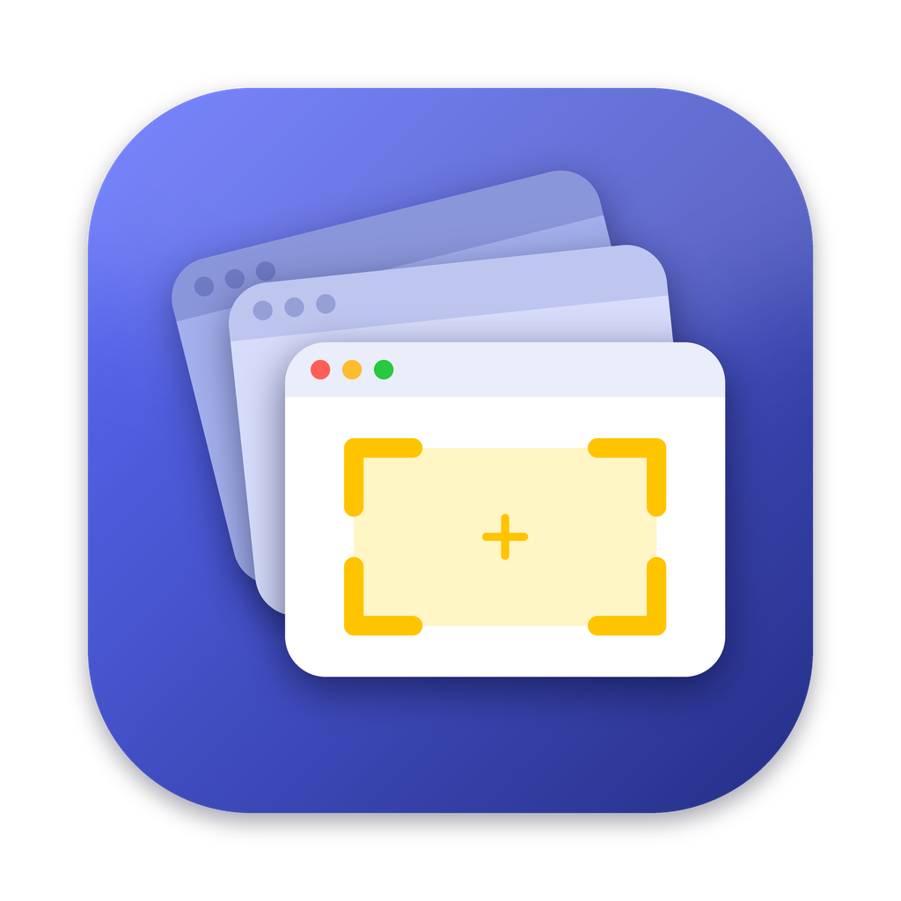

# QuickTab



**Alt+Tab как в Windows + скриншотер как Lightshot для macOS.**

Лёгкий переключатель окон для macOS в стиле Windows Alt+Tab: личная минималистичная версия.

**Возможности:** переключатель окон по `⌥Tab` / `⌘Tab` · необязательные превью окон · скриншоты со стоп-кадром · рисование поверх скриншота · распознавание текста (OCR) · закрепление скриншота поверх окон · пипетка цвета.
Переключатель и скриншотер включаются и выключаются **независимо** в меню (иконка в строке меню): можно пользоваться только одним из них.

[**Скачать последнюю версию**](https://github.com/lockermon4/alttab-windows-screenshoter-for-mac/releases/latest) · [Как установить](#установка) · [English](#english)

## English

QuickTab is a lightweight macOS menu-bar app: a Windows-style window switcher plus a Lightshot-style screenshot tool. Requires macOS 13+ (window previews and screenshots need macOS 14+).

**Features**
- Window switcher on `⌥Tab` or `⌘Tab` (replaces the system ⌘Tab while QuickTab runs; restored on quit). Never hangs: cached window list, background activation with timeouts.
- Optional window previews (off by default, needs Screen Recording).
- Freeze-frame screenshots (default `⌘⇧2`): drawing tools, text recognition (OCR), pin on top of other windows, color picker, copy or save to a folder.
- The switcher and the screenshot tool are enabled and disabled independently from the menu-bar icon.

**Install**
1. Download `QuickTab.zip` from [Releases](https://github.com/lockermon4/alttab-windows-screenshoter-for-mac/releases/latest) and move `QuickTab.app` to `/Applications`.
2. The app is not notarized, so Gatekeeper blocks the first launch. Either right-click `QuickTab.app` → **Open** → **Open**; or on macOS 15+ try to open it, then **System Settings → Privacy & Security → Open Anyway**; or run `xattr -dr com.apple.quarantine /Applications/QuickTab.app`.
3. Grant **Accessibility** (System Settings → Privacy & Security → Accessibility → QuickTab). For previews and screenshots also grant **Screen Recording**, then restart QuickTab from its menu. If QuickTab isn't in the Screen Recording list, click **+** below the list and pick `/Applications/QuickTab.app`. If AltTab or another switcher also uses ⌥Tab, quit it.

Build from source: `./scripts/setup-signing.sh` (once) and `./scripts/build-app.sh --install` (needs Xcode or Command Line Tools).

- **Для переключателя хватает «Универсального доступа».** По умолчанию в панели иконки и заголовки окон; «Запись экрана» нужна только для необязательных превью и скриншотов.
- **Не зависает при частом нажатии.**
  - Список окон всегда лежит готовым в кэше.
  - Клавиатуру слушает отдельный поток.
  - Все обращения к приложениям идут в фоне с таймаутом 0.25 с.
  - Окна поднимаются через WindowServer.
  - Каждое новое нажатие отменяет недоделанное предыдущее, поэтому подвисшее приложение не тормозит переключатель.
- Быстрое `⌥Tab` сразу переключает на предыдущее окно, панель даже не рисуется.
- **Превью окон — по желанию** (галочка в меню, по умолчанию выключена, macOS 14+). Для них нужна «Запись экрана»: без неё macOS не отдаёт картинку чужих окон ни одной программе. Снимки делаются в фоне и кэшируются, поэтому переключатель от них не тормозит.
- **Встроенные скриншоты со стоп-кадром** (как Lightshot/Shottr, macOS 14+). Нажал горячую клавишу (по умолчанию `⌘⇧2`, меняется в меню), экран замирает в этот момент, выделяешь область, и она уже в буфере обмена. «Запись экрана» нужна только этой необязательной функции, сам переключатель окон без неё обходится. Отключается в меню.

## Управление

| Клавиши | Действие |
|---|---|
| `⌥Tab` (держать `⌥`) | открыть / следующее окно |
| `⌥⇧Tab`, `←` `↑` | предыдущее окно |
| `→` `↓` | следующее окно |
| отпустить `⌥`, `Return`, клик мышью | переключиться |
| `Esc` | отмена |

В меню (иконка в строке меню) можно:
- включить / выключить переключатель окон (скриншоты при этом продолжают работать);
- переключить сочетание на `⌘Tab` (системный ⌘Tab при этом отключается);
  системный ⌘Tab возвращается, когда QuickTab завершается: через меню «Выйти», `pkill`, Ctrl+C в Терминале или при выходе из системы. Если QuickTab упал и системный ⌘Tab не работает, запусти QuickTab и выйди через меню или переключи в меню на «Сочетание ⌥Tab»; в крайнем случае поможет перезаход в систему;
- включить превью окон (попросит «Запись экрана»; после выдачи разрешения перезапусти QuickTab);
- включить автозапуск при входе.

## Скриншоты

Нажми горячую клавишу (по умолчанию `⌘⇧2`): экран замрёт, выдели мышью область, и картинка окажется в буфере обмена. Требуется macOS 14+.

В меню:
- «Скриншоты со стоп-кадром» — включить / выключить функцию;
- «Сделать скриншот» — то же, что горячая клавиша;
- «Горячая клавиша … — изменить…» — откроется окно, нажми новое сочетание (`Esc` — отмена);
- «После выделения»: «Сразу копировать» (по умолчанию) / «Копировать и сохранить в папку» / «Открывать панель рисования»;
- «Папка … — изменить…» — куда сохранять (по умолчанию `~/Pictures/QuickTab Screenshots`);
- «Открыть папку со скриншотами».

Совет: если держать `⌥`, отпуская мышь, откроется панель рисования даже в режиме «Сразу копировать».

| Клавиши (на стоп-кадре) | Действие |
|---|---|
| тянуть мышью | выделить область (за ручки — изменить размер, внутри — двигать) |
| `↩`, `⌘C`, двойной клик | скопировать и закрыть |
| `⌘S` | сохранить в папку (и скопировать) |
| `P` | закрепить поверх окон (перетаскивается, колесо — масштаб, двойной клик / `Esc` — закрыть, правый клик — меню) |
| `O` | распознать текст (OCR, русский + английский) и скопировать текст |
| `C` | скопировать HEX цвета под курсором (лупа) |
| `⌘Z` | отменить |
| `⌘A` | выделить весь экран |
| `V` `B` `L` `A` `R` `E` `M` `T` `X` | выделение, карандаш, линия, стрелка, прямоугольник, эллипс, маркер, текст, пикселизация |
| `⇧` при рисовании | квадрат / круг, линии под 45° |
| стрелки (`⇧` + стрелки) | сдвинуть курсор на 1 (10) px |
| правый клик | сбросить выделение, ещё раз — закрыть |
| `Esc` | закрыть |

При первом нажатии macOS попросит «Запись экрана». После выдачи разрешения перезапусти QuickTab (пункт меню «Перезапустить QuickTab»).

### Если просит «Запись экрана», хотя она включена
macOS привязывает разрешение к подписи приложения. Если поставить сборку с другой подписью (старые ad-hoc сборки из Actions, сборка без `./scripts/setup-signing.sh` или переход между своей сборкой и релизной), галочка в настройках остаётся, но уже не работает.

- **Из приложения.** Когда скриншот не получается, QuickTab показывает окно с кнопкой «Сбросить и разрешить заново». Она удаляет старую запись, заново запрашивает разрешение и открывает Системные настройки. Включи там QuickTab, и он сам перезапустится. То же самое есть в меню: «Скриншоты → Сбросить разрешение «Запись экрана»…».
- **Вручную.** Выполни команду ниже, затем снова включи QuickTab в настройках и перезапусти его:
  ```bash
  tccutil reset ScreenCapture io.github.lockermon4.quicktab
  ```
- **Чтобы больше не повторялось**, один раз выполни `./scripts/setup-signing.sh` и собирай через `./scripts/build-app.sh --install` (подробнее в разделе [Чтобы разрешения не слетали после пересборки](#чтобы-разрешения-не-слетали-после-пересборки)).

## Установка

### Вариант 1: готовая сборка
1. Скачай `QuickTab.zip` со страницы [**Releases**](https://github.com/lockermon4/alttab-windows-screenshoter-for-mac/releases/latest) и распакуй (двойной клик).
2. Перетащи `QuickTab.app` в папку **Программы** (`/Applications`).
3. **Первый запуск.** Приложение не нотаризовано Apple (нет платного Developer ID), поэтому macOS сначала его заблокирует («не удаётся проверить разработчика»). Обойти можно любым способом:
   - правый клик по `QuickTab.app` → **Открыть** → **Открыть**;
   - или, если такой кнопки нет (macOS 15+): попробуй открыть, затем **Системные настройки → Конфиденциальность и безопасность** → внизу «QuickTab заблокирован» → **Всё равно открыть**;
   - или одной командой в Терминале:
     ```bash
     xattr -dr com.apple.quarantine /Applications/QuickTab.app
     ```
4. **Разрешения.** macOS попросит «Универсальный доступ», он нужен для переключателя окон:
   **Системные настройки → Конфиденциальность и безопасность → Универсальный доступ → QuickTab ✓**.
   Для превью окон и скриншотов дополнительно нужна **«Запись экрана»** (там же). После выдачи разрешения перезапусти QuickTab (пункт меню «Перезапустить QuickTab»).
   Если QuickTab нет в списке «Записи экрана», нажми **+** под списком и выбери `/Applications/QuickTab.app`. Если AltTab или другой переключатель тоже занимает ⌥Tab, закрой его.

**Обновление:** скачай новый `QuickTab.zip` и замени приложение в «Программах». Разрешения сохранятся: все релизные сборки подписаны одним сертификатом. Если macOS всё же снова просит разрешения, см. [Если просит «Запись экрана», хотя она включена](#если-просит-запись-экрана-хотя-она-включена).

### Вариант 2: собрать самому
Нужны Xcode или Command Line Tools (`xcode-select --install`).
```bash
git clone https://github.com/lockermon4/alttab-windows-screenshoter-for-mac.git QuickTab && cd QuickTab
./scripts/setup-signing.sh      # один раз: личный сертификат, чтобы разрешения не слетали
./scripts/build-app.sh --install
```

### Чтобы разрешения не слетали после пересборки
По умолчанию приложение подписывается ad-hoc, и подпись меняется при каждой сборке. macOS привязывает разрешения к подписи. Поэтому старая запись в «Универсальном доступе» остаётся включённой, но уже не работает.

Чтобы этого не было, **один раз** создай личный сертификат (macOS спросит пароль):
```bash
./scripts/setup-signing.sh
```
После этого собирай и ставь одной командой, разрешения сохранятся:
```bash
./scripts/build-app.sh --install
```

Если разрешения уже «сломались», сбрось их и выдай заново:
```bash
tccutil reset Accessibility io.github.lockermon4.quicktab; tccutil reset ScreenCapture io.github.lockermon4.quicktab
```

### Подпись сборок на GitHub (для владельца репозитория)
GitHub Actions подписывает каждую сборку одним постоянным сертификатом «QuickTab Dev» из секретов репозитория, поэтому macOS не сбрасывает «Универсальный доступ» и «Запись экрана» при обновлении. Без секретов сборка подписывается ad-hoc.

Чтобы настроить, **один раз** выполни на своём Mac:
```bash
./scripts/setup-ci-signing.sh
```
Скрипт:
- создаёт новый сертификат «QuickTab Dev» (заменяет старый локальный), ставит его и делает доверенным;
- сохраняет его копию в `~/.quicktab-signing/`;
- загружает секреты `QUICKTAB_P12_BASE64` и `QUICKTAB_P12_PASSWORD` в репозиторий через `gh`. Для этого нужен `gh auth login`. Без `gh` скрипт напечатает, что добавить вручную: **Settings → Secrets and variables → Actions → New repository secret**.

После этого локальные сборки и сборки с GitHub подписаны одинаково. Пересобери приложение и один раз выдай разрешения заново (сертификат сменился):
```bash
./scripts/build-app.sh --install
```

Выпустить релиз: создай тег `v*`, Actions соберёт `QuickTab.zip` и выложит его в Releases.
```bash
git tag v1.2.0 && git push origin v1.2.0
```

## Устройство

| Файл | Что делает |
|---|---|
| `WindowTracker.swift` | Список окон в порядке использования. AXObserver'ы на отдельном потоке, начальный порядок по z-order из `CGWindowList` (без записи экрана). |
| `HotkeyTap.swift` | CGEventTap на своём потоке. Ловит и горячую клавишу скриншота. |
| `Activator.swift`, `SkyLight.swift` | Переключение на окно: фоновая очередь, «побеждает последнее нажатие». |
| `SwitcherPanel.swift` | Панель (NSPanel, не забирает фокус). |
| `Previews.swift` | Необязательные миниатюры через ScreenCaptureKit, фон + кэш. |
| `Screenshot/ScreenshotController.swift` | Скриншоты: оркестрация, буфер обмена, сохранение, OCR через Vision. |
| `Screenshot/ScreenGrabber.swift` | Снимок всех дисплеев через ScreenCaptureKit; список дисплеев закэширован, поэтому стоп-кадр мгновенный. |
| `Screenshot/ScreenshotOverlay.swift` | Окно стоп-кадра: выделение, инструменты рисования, лупа, панель инструментов. |
| `Screenshot/PinWindow.swift` | Закреплённый поверх окон скриншот. |
| `Screenshot/HotkeyRecorder.swift` | Окно записи новой горячей клавиши. |
| `Screenshot/ScreenshotSettings.swift` | Настройки скриншотов. |

Требуется macOS 13+ (превью окон и скриншоты — macOS 14+).

## Выпуск релиза (для автора)

Релиз собирает GitHub Actions по тегу и подписывает его постоянным сертификатом «QuickTab Dev» из секретов репозитория (настройка один раз: `./scripts/setup-ci-signing.sh`, см. выше). Тогда у пользователей не слетают разрешения после обновления.

1. Подними `CFBundleShortVersionString` / `CFBundleVersion` в `Resources/Info.plist` и обнови `.github/release-notes.md`.
2. `git tag v<версия> && git push origin v<версия>` — CI соберёт `QuickTab.zip` и опубликует релиз.

Локально то же самое собирает `./scripts/release.sh` (zip + dmg в `build/`).

## Лицензия / License

MIT — см. [LICENSE](LICENSE).
